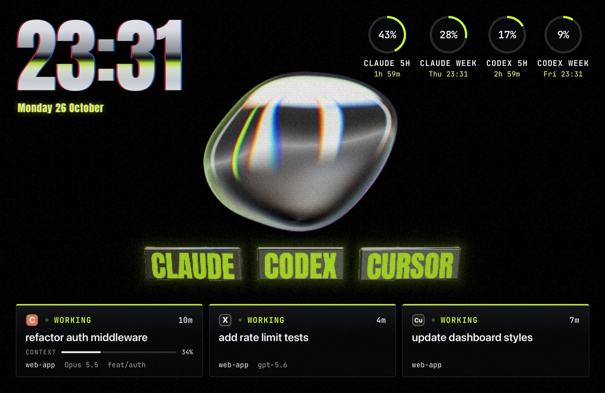
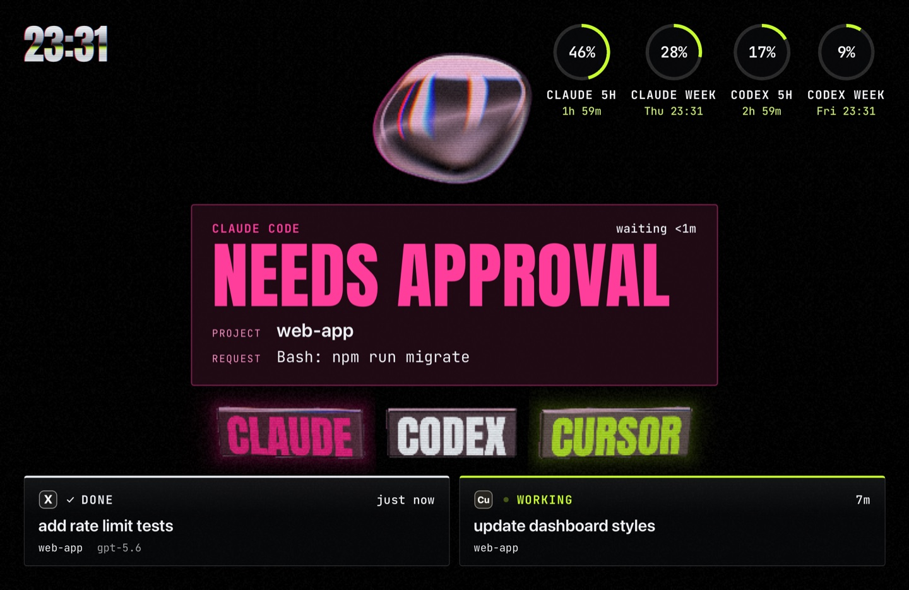
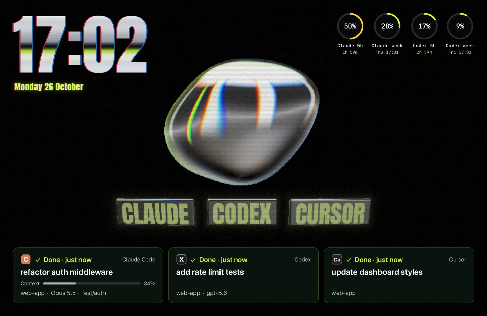
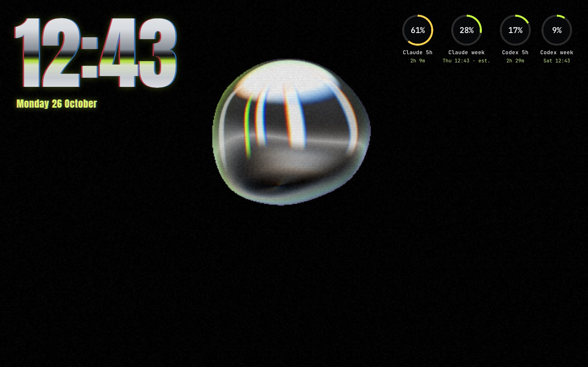
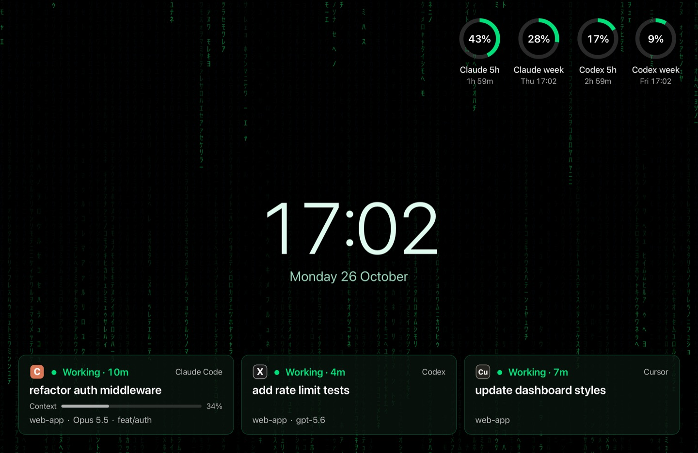
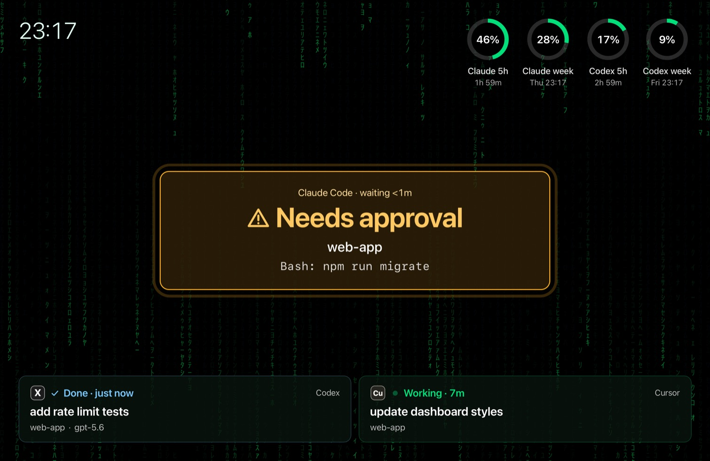
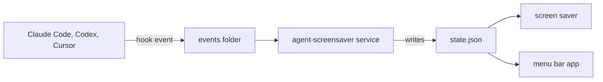

# agent-screensaver

A macOS screen saver that shows what your AI coding agents are doing.


[](LICENSE)


https://github.com/user-attachments/assets/588e6f6f-617a-4842-9c8f-d854756a434b


You start a long task in Claude Code, Codex or Cursor and walk away. When you come back, you see from across the room if an agent needs you, which tasks finished, which are still running and for how long, and how much of your usage limits is left. The screen saver shows the time anyway while you are away, so it is the right place to show this too.

## What it does

Each agent task gets a card: what it works on, for how long, its project, model and branch, and how full the context is. The rings show how much of your 5-hour and weekly limits is used and when they reset. When an agent waits for your approval, a large card says which agent, which project and what it wants to run. A sound plays when the screen saver is showing. With no tasks, you see the clock and your limits. A second display shows only the background and the clock.

The pictures are of the real screen saver with made-up data. First the Chrome theme:

<table>
  <tr>
    <td><br>Three agents working</td>
    <td><br>An agent needs approval</td>
  </tr>
  <tr>
    <td><br>All three tasks finished</td>
    <td><br>No tasks: the clock and your limits</td>
  </tr>
</table>

The Default theme, on a Matrix background:

<table>
  <tr>
    <td><br>Three agents working</td>
    <td><br>An agent needs approval</td>
  </tr>
</table>

A third theme, Calm, plays the Apple aerial videos that macOS has already downloaded. It has no picture here because the footage belongs to Apple. The Chrome theme needs WebGL2 and uses more CPU than the others, see [Known limits](docs/known-limits.md).

More themes are in [agent-screensaver-themes](https://github.com/stavgayer/agent-screensaver-themes). The first seven are inspired by album covers. Install only the ones you like:

https://github.com/user-attachments/assets/9a1826d2-a335-49b4-98be-1e8459d3d9ff

## Install

You need macOS 14 or later, on Apple Silicon or Intel.

1. Download `agent-screensaver-<version>-macos.zip` from the [Releases page](https://github.com/stavgayer/agent-screensaver/releases) and unzip it.
2. Open Terminal in the unzipped folder and run `./agent-screensaver install`.
3. Read the plan it prints. It lists every change it will make.
4. Type `y` to confirm.

Install also creates a small app, `Agent Screensaver`, in `~/Applications`. Spotlight, Launchpad and Finder find it, and it opens the settings window. It needs no admin password. If `~/Applications` does not exist, install creates it. If a file or folder named `Agent Screensaver.app` is already there and it is not ours, install leaves it alone and says so in the plan.

### Open Anyway (one time)

The screen saver is not signed with an Apple Developer account. macOS blocks it the first time. To allow it:

1. Open System Settings, then Privacy & Security.
2. Find the message about AgentScreensaver and click "Open Anyway".

You do this once.

### Choose the screen saver

Open System Settings, then Screen Saver, and pick AgentScreensaver.

### Approve the Codex hooks

In Codex, run `/hooks` and approve the new agent-screensaver hooks. Codex asks you to trust new hooks once.

### Lock the screen right away

Open System Settings, then Lock Screen. Set "Require password after screen saver begins" to Immediately.

### Uninstall

Run `./agent-screensaver uninstall` and confirm the plan. Your settings and extensions in the data folder are kept. Uninstall also deletes `~/Applications/Agent Screensaver.app`, but only when it is our app. It keeps the `~/Applications` folder.

Your agents' settings files are safe. Install only adds its own hooks to files such as `~/.claude/settings.json`, and saves a copy of each file first, next to it, with the ending `.agent-screensaver.bak`. Uninstall removes only the entries that install added, so each file gets back the same keys and values. It keeps the indent per level (tabs, or the number of spaces of its first indented line) and whether the file ends with a newline, but not every other part of the layout: see [known limits](docs/known-limits.md). A file that install creates gets two spaces. A status line command of your own is saved at install and put back at uninstall.

## How it works



1. Each agent runs a small hook command on its events: a prompt sent, a tool about to run, an approval asked, a task done. The hook writes the event to a folder and exits at once.
2. A service on your Mac reads the events, keeps the state of every task and reads your usage limits from local files. It writes the result to `state.json`.
3. The screen saver and the menu bar app read `state.json` and show it.

Everything lives in `~/Library/Application Support/agent-screensaver`.

Privacy:

- No network. agent-screensaver sends nothing anywhere. The only program it talks to is `codex app-server` on your Mac, which it starts to read the Codex limits and then stops.
- No login tokens. Limits come from what the agents themselves give: the Claude Code status line, files that Claude Code and the Claude desktop app write on your disk, and the Codex app-server.
- Transcripts are read, never sent. The service reads your agents' local transcripts only for the session name, the model and token counts (for how full the context is and the Claude "est." limit). It takes no prompt text from them.
- Prompts are masked. A card title made from a prompt has its secrets masked and is cut to 40 characters. Privacy mode (`./agent-screensaver privacy on`) also hides card titles, requests, names and branches.

## Supported agents

| Agent | Cards | Approval cards | Usage rings |
| --- | --- | --- | --- |
| Claude Code | Working, done | Yes | 5 hours and week. Exact when Claude Code or the Claude desktop app gives a reading, else estimated from your transcripts and marked "est." |
| Codex | Working, done | Yes | 5 hours and week, from the local `codex app-server` |
| Cursor | Working (with the current command), done | No | No |

Cursor shows no approval cards because it does not tell a hook when it will really ask you. It has no usage ring because it keeps your usage on its server only. `codex exec` runs show no card. The details are in [docs/agents.md](docs/agents.md) and [docs/known-limits.md](docs/known-limits.md).

Sessions you start from [T3 Code](https://github.com/pingdotgg/t3code) show too, with no extra setup: T3 Code runs the same Claude Code, Codex and Cursor tools, so the same hooks fire. Tested with T3 Code 0.1.2 (beta): working and done cards for all three. Approval cards and T3's worktree mode were not tested yet.

You can add other agents yourself, without changing our code: see [Add an agent](docs/guides/add-an-agent.md).

## Make it yours

Everything on the screen is an extension: the clock, the cards, the rings, the backgrounds and the themes. The built-in ones use the same public API as yours.

- [How-to guides](docs/guides/README.md), each with a tested sample:
  - [Add an agent](docs/guides/add-an-agent.md)
  - [Add a widget](docs/guides/add-a-widget.md)
  - [Add a background](docs/guides/add-a-background.md)
  - [Create a theme](docs/guides/create-a-theme.md)
  - [Change the layout](docs/guides/change-the-layout.md)
  - [Test and share](docs/guides/test-and-share.md)
- [Writing extensions](docs/extensions.md): the manifest and the web API.
- [Agent extensions](docs/agents.md): teach agent-screensaver a new coding agent. The project ships no company logos; you may add your own icon for any agent.
- [Event format](docs/event-format.md): the event your own program can send.

## Settings window and menu bar

The menu bar app shows how many agents wait and run, your limits, and each open approval. Its icon changes when an agent waits for you. From its menu you can preview the screen saver, open the settings window, and turn the sound and privacy mode on or off.

The settings window has five parts: Theme & background, Extension options, Extensions, Agents (add or remove an agent's hooks, turn an agent off) and General. To install a theme or any other extension, drop its `.zip` file or folder on the window, or click Install… under Extensions. You do not need Terminal for this. On a Mac with a notch, a full menu bar can hide the app's icon behind the notch. Then open Spotlight or Launchpad and search for "Agent Screensaver". It is the launcher app that install puts in `~/Applications`. If you do not find it, run `./agent-screensaver settings` in Terminal to open the settings window directly.

To hide the sessions of a folder, add its name under General, Ignored projects, in the settings window. They then get no card, no approval and no sound. The list starts with `observer-sessions`, the folder where the claude-mem plugin runs its hidden Claude sessions.

You can also change settings with `agent-screensaver` commands, run from the unzipped folder. One example each:

| Command | Example |
| --- | --- |
| `theme` | `./agent-screensaver theme set builtin.chrome` |
| `background` | `./agent-screensaver background set builtin.aerials` |
| `option` | `./agent-screensaver option set builtin.matrix color "#00ff66"` |
| `privacy` | `./agent-screensaver privacy on` |
| `sound` | `./agent-screensaver sound on` |
| `fps` | `./agent-screensaver fps max 30` |
| `ext` | `./agent-screensaver ext install ./my-theme-pack.zip` |
| `demo` | `./agent-screensaver demo --seconds 60` |

Run `./agent-screensaver theme list` to see the themes you can use.

`demo` plays a made-up scene with three agents, for a screen recording. It starts when the screen saver next shows and plays for the seconds you give (10 to 600, 60 if you give none). Start the screen saver within 5 minutes, or the demo is dropped. It ends when the screen saver stops, and a real approval request ends it at once. `./agent-screensaver demo stop` ends it early. Privacy mode does not hide the demo text, because none of it is real. [docs/media/README.md](docs/media/README.md) tells how the pictures above were made and how to record a video.

## FAQ

**Does it work with the Claude Code desktop app?**
Yes. The desktop app runs no status line, so between exact readings the Claude rings are estimated from your transcripts and marked "est.".

**Why does my Cursor card never ask for approval?**
Cursor sends the same hook event before every command, also when it will not ask you, and does not say which. So Cursor cards show the command as working.

**How do I hide one project?**
Add its folder name under General, Ignored projects. Upper and lower case do not count: `My-App` also hides `my-app`.

**The menu bar icon is gone.**
It can hide behind the notch. Search for "Agent Screensaver" in Spotlight or Launchpad, or run `./agent-screensaver settings`.

**Can I install an extension from a zip?**
Yes. Drop the zip on the settings window, click Install… under Extensions, or run `./agent-screensaver ext install`. `extension.json` must be at the top of the zip or inside its only top folder. A zip made with Finder's Compress on a folder works.

More in [Known limits](docs/known-limits.md). The reasons behind the bigger choices are in [docs/decisions/](docs/decisions/).

## Contributing

You need Go, Node, and the Xcode command line tools. Build the release zip with:

```
scripts/build-release.sh
```

It builds a universal binary and the screen saver, and writes `dist/agent-screensaver-<version>-macos.zip`.

Run the tests with `go test ./...` and `cd web && npm test`. [Test and share](docs/guides/test-and-share.md) shows the dev preview and the screenshot harness. Issues and pull requests are welcome.

## License

[MIT](LICENSE). Bundled fonts keep their own licence (SIL OFL), in a file next to them.
